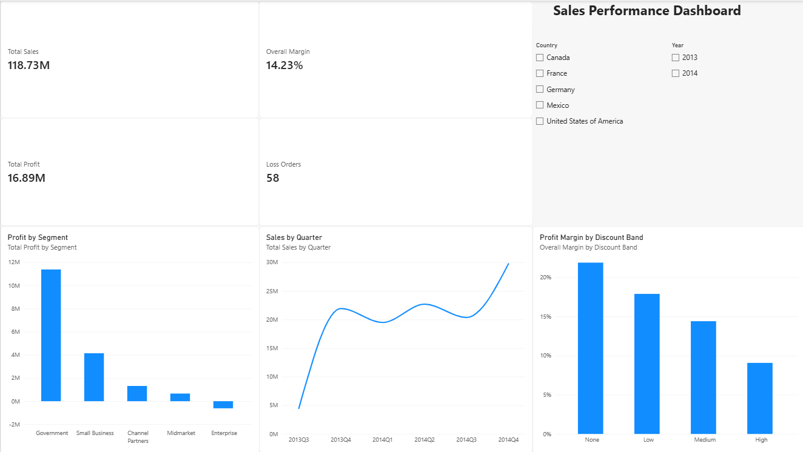
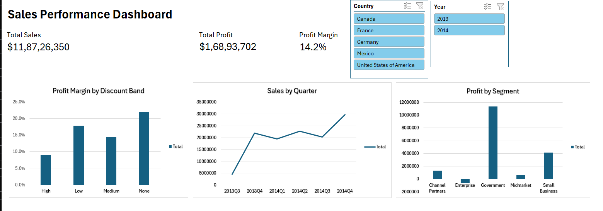

# Sales Performance Analysis: End-to-End Case Study

An end-to-end analysis of a sales dataset using Python (Pandas), Excel and Power BI. This is my Week 4 capstone project for the Data Analyst Course.

**Full report:** [Capstone_Report.pdf](Capstone_Report.pdf)

## Dashboard Preview

### Power BI

### Excel

## Dataset

- File: `sales_data.csv` (original) and `cleaned_sales_data.csv` (cleaned)
- 700 orders and 16 original columns, from September 2013 to December 2014
- 5 segments, 5 countries, 6 products and 4 discount bands
- Key columns: Segment, Country, Product, Discount Band, Units Sold, Gross Sales, Discounts, Sales, COGS, Profit, Date

## Project Steps

1. **Clean and explore (Python):** removed the stray space from the " Sales" column name, kept the Discount Band value "None" as a real category (Pandas reads it as missing by default), converted Date to a date format, and checked for missing values and duplicates (none found)
2. **New columns:** Profit Margin %, Quarter and Loss Making (Yes or No)
3. **Analyse (Pandas):** summarised sales, profit and margin by segment, discount band, product, country and quarter
4. **Visualise (Excel):** pivot tables, pivot charts, a calculated field for margin, KPI cells and slicers
5. **Visualise (Power BI):** DAX measures, KPI cards, charts and slicers
6. **Report:** a PDF with findings, charts, recommendations and a stakeholder summary

## Key Results

| Measure | Value |
|---|---|
| Total Sales | 118.73M |
| Total Profit | 16.89M |
| Profit Margin | 14.23% |
| Loss-making orders | 58 |

### Profit by Segment

| Segment | Sales | Profit | Margin |
|---|---|---|---|
| Government | 52,504,261 | 11,388,173 | 21.7% |
| Small Business | 42,427,918 | 4,143,168 | 9.8% |
| Enterprise | 19,611,694 | -614,546 | -3.1% |
| Midmarket | 2,381,883 | 660,103 | 27.7% |
| Channel Partners | 1,800,594 | 1,316,803 | 73.1% |

### Margin by Discount Band

| Discount Band | Orders | Margin |
|---|---|---|
| None | 53 | 21.9% |
| Low | 160 | 17.9% |
| Medium | 242 | 14.4% |
| High | 245 | 9.1% |

## Key Insights

- The bigger the discount, the lower the profit margin, falling from 21.9% (no discount) to 9.1% (high discount)
- All 58 loss-making orders are Enterprise orders with a High (33) or Medium (25) discount, and they lost 777,321 in total
- Government earns 67% of all profit
- Channel Partners has the highest margin (73%) but the smallest sales (1.80M)
- Sales from September to December 2014 are about 37% higher than the same months in 2013, and 2014 Q4 is the best quarter (29.76M)

## Recommendations

1. Require approval for Medium and High discounts on Enterprise orders
2. Review the overall discount policy and set limits on High discounts
3. Test ways to grow the high-margin Channel Partners and Midmarket segments
4. Protect the Government segment and reduce dependence on it over time
5. Prepare for a strong fourth quarter

## Limitations

- The data covers only 14 months, and 2013 has only four months (September to December)
- This looks like a sample dataset, so results should be checked against full company data
- The analysis shows relationships, not proven causes

## Files

| File | Description |
|---|---|
| `capstone_analysis.ipynb` | Python notebook with cleaning, analysis and charts |
| `sales_data.csv` | Original dataset |
| `cleaned_sales_data.csv` | Cleaned dataset |
| `capstone_dashboard.xlsx` | Excel pivot tables, charts and dashboard |
| `capstone_dashboard.pbix` | Power BI dashboard (open with Power BI Desktop) |
| `Capstone_Report.pdf` | Final report |
| `*.png` | Charts and dashboard screenshots |

## Tools Used

- Python 3.13 (Pandas, NumPy, Matplotlib, Seaborn) in Jupyter Notebook (VS Code)
- Microsoft Excel
- Microsoft Power BI Desktop

## How to Run

1. Install the libraries: `python -m pip install pandas matplotlib seaborn ipykernel`
2. Put `sales_data.csv` in the same folder as the notebook
3. Open `capstone_analysis.ipynb` and click Run All
